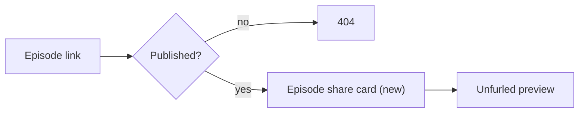
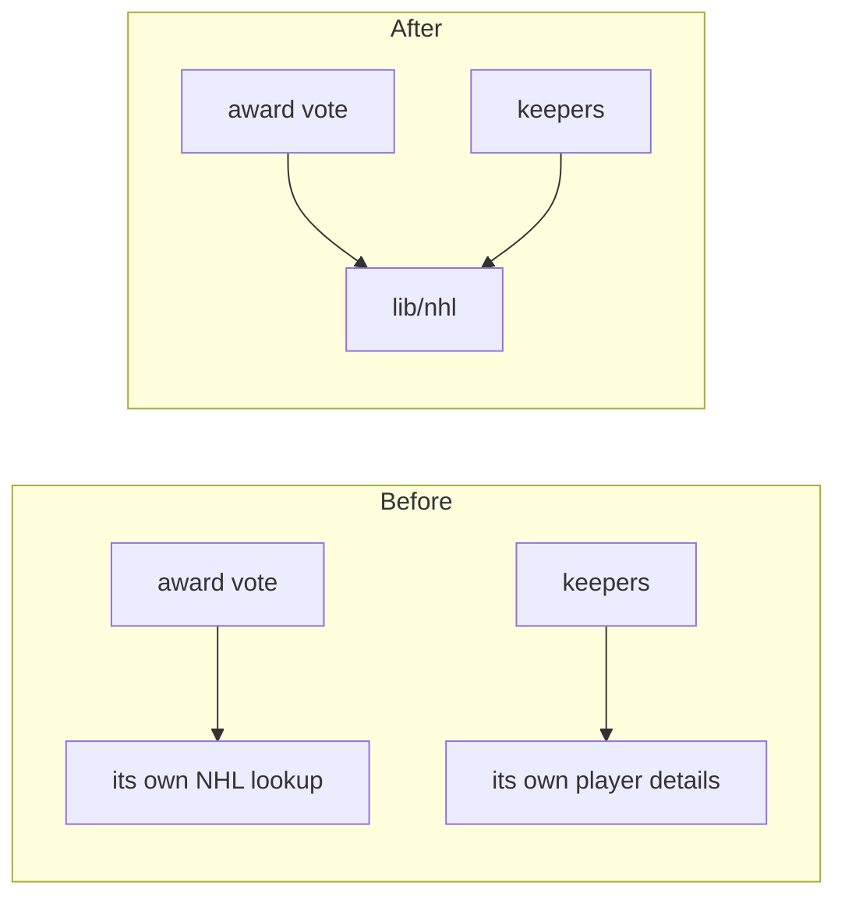
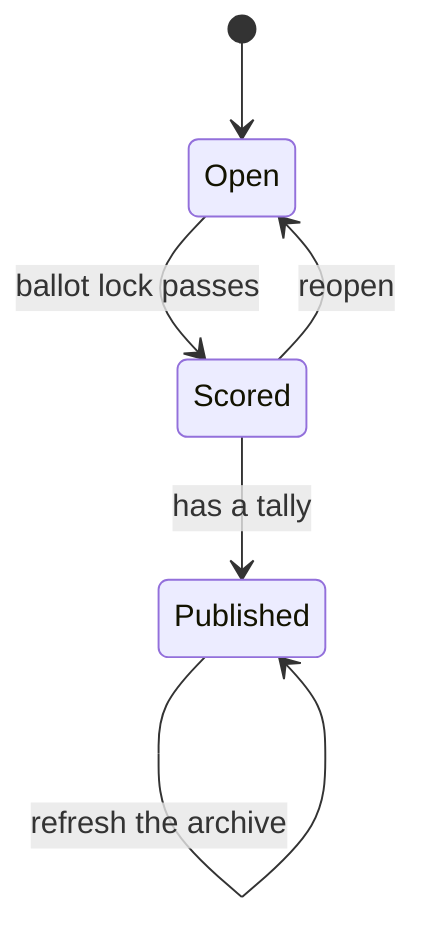

Call the Skill tool with `unslop` before you write, and apply its rules to the prose in every section. The template's headings are a fixed format and stay as they are.

Use this template for writing the PR body:

```markdown
## Summary

<one sentence: what a person can now do that they could not before>

<one visual: a before and after table, a Mermaid diagram, or a numbers table>

## Evidence

- **Before:** <screenshot/output/failing test run>
  **After:** <screenshot/output/passing test run>

## Merge Danger

**Door:** <one-way or two-way>

<optional: description>

**Blast Radius:** <one-word description>

<optional: potential ramifications of merge>
```

## Sections

Skip all preambles and keep prose brief. Use the user's domain language from `GLOSSARY.md`.

### Summary

One sentence, then one visual. The sentence says what a person can now do that they could not before, or what now holds that did not. The visual shows the same thing at a glance.

For a bug fix, the sentence also states the root cause, from the fix spec's `## Root cause`. After the sentence and the visual, one line says the PR closes the fix spec's issue.

The visual carries the benefit of the change, not its shape. A reviewer reads the diff for the shape. So do not open with a file tree, a diff sketch or a call stack. They describe the edit rather than the gain, they go stale on the next commit, and they push the point below the fold.

Pick one visual, by what kind of change this is.

**Behaviour changed, or a bug is fixed: a before and after table.** One row per thing a person does or sees. Name that thing in the left column, in glossary terms.

| | Before | After |
| --- | --- | --- |
| Career FP/G | Mean of each season's FP/G, over seasons with points | Career points divided by career games played |
| A season with games but no points | Left out of the average | Counted |
| Goalies | No games played on record | Games played from the morning sync |

**A path through the system changed: a Mermaid flowchart.** Use it when the change adds a route, removes a step, or sends one somewhere else. Say which node is new in its own label.



**Several callers became one rule: a Mermaid flowchart with the before and after side by side.** This is the refactor case. The benefit is the number of call sites that now share one rule, so count them in the diagram.



**A state model changed: a Mermaid state diagram.** Use it when the change adds a state, or allows a transition that was impossible before.



**Speed, cost or size changed: a numbers table.** Give the metric, the before, the after, and how you measured it.

| Metric | Before | After |
| --- | --- | --- |
| Evening Fantrax refresh | Every night, 40s | Skipped when nothing changed |
| Function invocations per day | 1,440 | 12 |

Rules for all of them:

- One visual. If a second one seems necessary, the sentence above it is not doing its job.
- Keep it under about twelve rows or nodes. A reviewer should take it in without scrolling.
- Label every row and node in the project's own language, from `GLOSSARY.md`.
- Never let colour be the only signal, because a reader may be colour blind. Put the word "new" in the label.
- Mermaid renders on GitHub, GitLab and most viewers. A table renders everywhere. Prefer the table when the change is a list of behaviours rather than a shape.
- Quote a Mermaid label that contains brackets, parentheses or a colon, as in `D["Episode share card (new)"]`, or the diagram fails to parse.

If the structure of the change is worth showing too, put it below the Summary under its own heading, and keep it to the files, calls or props a reviewer needs. A component tree, a file tree or a short call tree works there. Still no diff sketches.

### Evidence

Concrete evidence that the change works. Show a before and after.

Screenshots are S-tier - when the environment is set up for it and the change is visual.

Execution-based evidence is A-tier. Test results, console output. Paste the real output of the run where the test fails before the change and the run where it passes after. Use pseudocode only to show what the test does, beside that output and never in its place.

For a bug fix, the output is what `## Fixing a bug` in `tdd` has the implementer keep. Copy it from the implementer's report.

### Merge Danger

Describe whether it's a one-way or two-way door. You can walk back through two-way doors, but not one-way doors. A PR that is cheap to roll back is lower risk. Changes that involve destructive actions or hard-to-reverse decisions are one-way doors.

The blast radius is the potential impact or scope of the changes introduced by this PR. Consider all possibilities. Examples are layout shift, breakages for consumers, mobile responsiveness, etc.

---

Adapted from [mattpocock/skills](https://github.com/mattpocock/skills), by Matt Pocock, MIT, and from [`show-me`](https://github.com/humanlayer/skills/blob/main/plugins/show-me/skills/show-me/SKILL.md) in humanlayer/skills, by Dex Horthy at HumanLayer, MIT. See [LICENSE](./LICENSE) and [CREDITS.md](./CREDITS.md).
